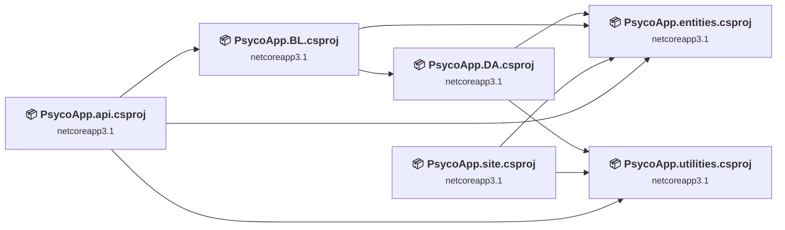
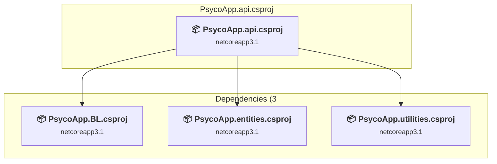
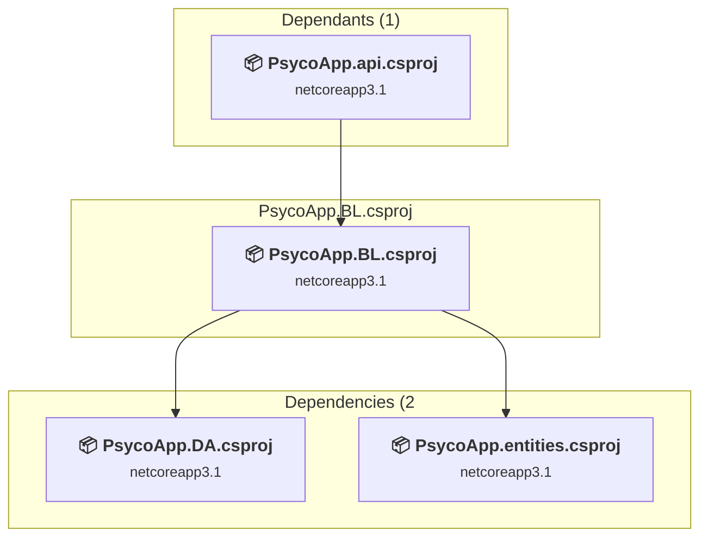
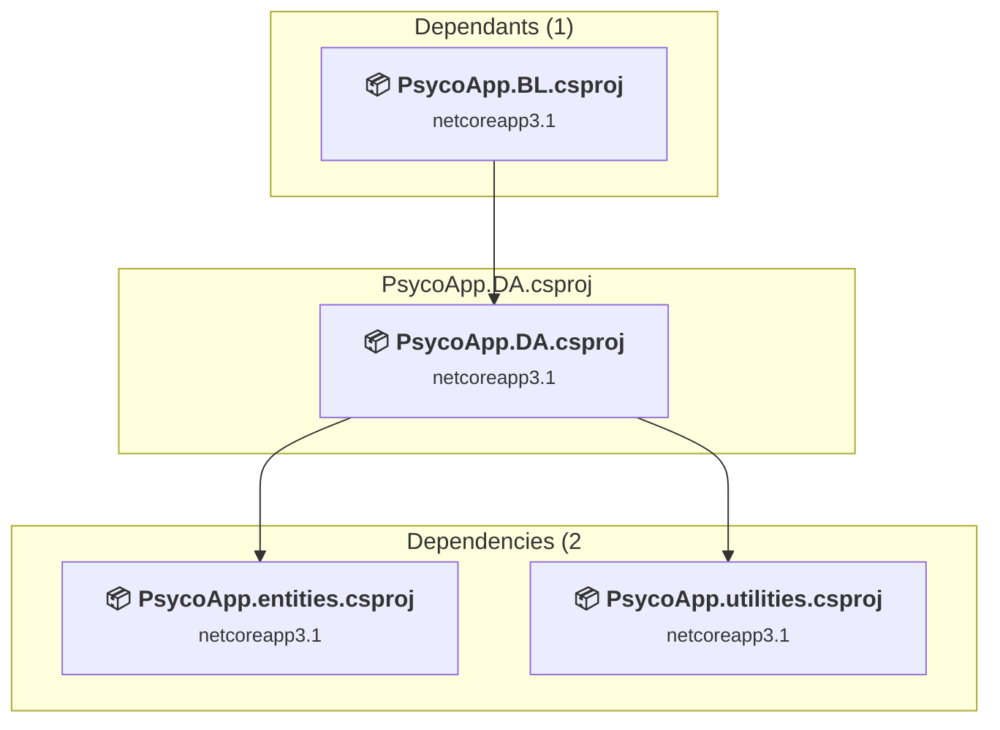
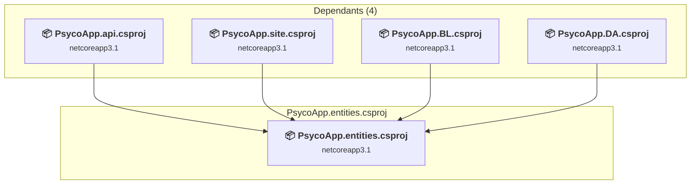
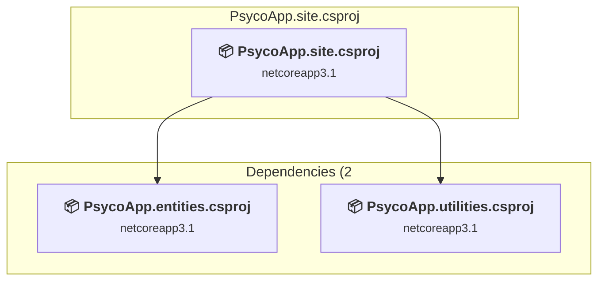
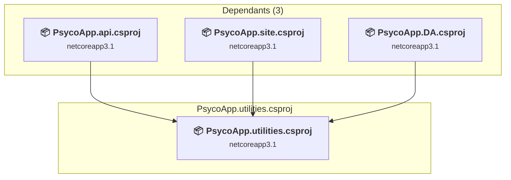

# Projects and dependencies analysis

This document provides a comprehensive overview of the projects and their dependencies in the context of upgrading to .NETCoreApp,Version=v10.0.

## Table of Contents

- [Executive Summary](#executive-Summary)
  - [Highlevel Metrics](#highlevel-metrics)
  - [Projects Compatibility](#projects-compatibility)
  - [Package Compatibility](#package-compatibility)
  - [API Compatibility](#api-compatibility)
  - [Binding Redirect Configuration](#binding-redirect-configuration)
- [Aggregate NuGet packages details](#aggregate-nuget-packages-details)
- [Top API Migration Challenges](#top-api-migration-challenges)
  - [Technologies and Features](#technologies-and-features)
  - [Most Frequent API Issues](#most-frequent-api-issues)
- [Projects Relationship Graph](#projects-relationship-graph)
- [Project Details](#project-details)

  - [PsycoApp.api\PsycoApp.api.csproj](#psycoappapipsycoappapicsproj)
  - [PsycoApp.BL\PsycoApp.BL.csproj](#psycoappblpsycoappblcsproj)
  - [PsycoApp.DA\PsycoApp.DA.csproj](#psycoappdapsycoappdacsproj)
  - [PsycoApp.Entities\PsycoApp.entities.csproj](#psycoappentitiespsycoappentitiescsproj)
  - [PsycoApp.site\PsycoApp.site.csproj](#psycoappsitepsycoappsitecsproj)
  - [PsycoApp.utilities\PsycoApp.utilities.csproj](#psycoapputilitiespsycoapputilitiescsproj)

## Executive Summary

### Highlevel Metrics

| Metric | Count | Status |
| :--- | :---: | :--- |
| Total Projects | 6 | All require upgrade |
| Total NuGet Packages | 279 | 10 need upgrade |
| Total Code Files | 165 |  |
| Total Code Files with Incidents | 36 |  |
| Total Lines of Code | 22640 |  |
| Total Number of Issues | 2918 |  |
| Estimated LOC to modify | 2890+ | at least 12.8% of codebase |

### Projects Compatibility

| Project | Target Framework | Difficulty | Package Issues | API Issues | Binding Issues | Est. LOC Impact | Description |
| :--- | :---: | :---: | :---: | :---: | :---: | :---: | :--- |
| [PsycoApp.api\PsycoApp.api.csproj](#psycoappapipsycoappapicsproj) | netcoreapp3.1 | 🟢 Low | 6 | 12 | 0 | 12+ | AspNetCore, Sdk Style = True |
| [PsycoApp.BL\PsycoApp.BL.csproj](#psycoappblpsycoappblcsproj) | netcoreapp3.1 | 🟢 Low | 0 | 0 | 0 |  | ClassLibrary, Sdk Style = True |
| [PsycoApp.DA\PsycoApp.DA.csproj](#psycoappdapsycoappdacsproj) | netcoreapp3.1 | 🟢 Low | 4 | 2843 | 0 | 2843+ | ClassLibrary, Sdk Style = True |
| [PsycoApp.Entities\PsycoApp.entities.csproj](#psycoappentitiespsycoappentitiescsproj) | netcoreapp3.1 | 🟢 Low | 2 | 0 | 0 |  | ClassLibrary, Sdk Style = True |
| [PsycoApp.site\PsycoApp.site.csproj](#psycoappsitepsycoappsitecsproj) | netcoreapp3.1 | 🟢 Low | 5 | 32 | 0 | 32+ | AspNetCore, Sdk Style = True |
| [PsycoApp.utilities\PsycoApp.utilities.csproj](#psycoapputilitiespsycoapputilitiescsproj) | netcoreapp3.1 | 🟢 Low | 5 | 3 | 0 | 3+ | ClassLibrary, Sdk Style = True |

### Package Compatibility

| Status | Count | Percentage |
| :--- | :---: | :---: |
| ✅ Compatible | 269 | 96.4% |
| ⚠️ Incompatible | 2 | 0.7% |
| 🔄 Upgrade Recommended | 8 | 2.9% |
| ***Total NuGet Packages*** | ***279*** | ***100%*** |

### API Compatibility

| Category | Count | Impact |
| :--- | :---: | :--- |
| 🔴 Binary Incompatible | 6 | High - Require code changes |
| 🟡 Source Incompatible | 2870 | Medium - Needs re-compilation and potential conflicting API error fixing |
| 🔵 Behavioral change | 14 | Low - Behavioral changes that may require testing at runtime |
| ✅ Compatible | 17354 |  |
| ***Total APIs Analyzed*** | ***20244*** |  |

## Aggregate NuGet packages details

| Package | Current Version | Suggested Version | Projects | Description |
| :--- | :---: | :---: | :--- | :--- |
| IBM.Cloud.SDK.Core | 1.1.0 |  | [PsycoApp.site.csproj](#psycoappsitepsycoappsitecsproj) | ✅Compatible |
| IBM.Watson.Assistant.v2 | 4.5.0 |  | [PsycoApp.site.csproj](#psycoappsitepsycoappsitecsproj) | ✅Compatible |
| IBM.Watson.Common | 4.5.0 |  | [PsycoApp.site.csproj](#psycoappsitepsycoappsitecsproj) | ✅Compatible |
| IBM.WatsonDeveloperCloud | 2.16.0 |  | [PsycoApp.site.csproj](#psycoappsitepsycoappsitecsproj) | ✅Compatible |
| JsonSubTypes | 1.6.0 |  | [PsycoApp.site.csproj](#psycoappsitepsycoappsitecsproj) | ✅Compatible |
| JWT | 5.1.1 |  | [PsycoApp.site.csproj](#psycoappsitepsycoappsitecsproj) | ✅Compatible |
| Microsoft.ApplicationInsights | 2.22.0 |  | [PsycoApp.api.csproj](#psycoappapipsycoappapicsproj) | ✅Compatible |
| Microsoft.ApplicationInsights.AspNetCore | 2.22.0 |  | [PsycoApp.api.csproj](#psycoappapipsycoappapicsproj) | ⚠️El paquete NuGet está en desuso |
| Microsoft.ApplicationInsights.DependencyCollector | 2.22.0 |  | [PsycoApp.api.csproj](#psycoappapipsycoappapicsproj) | ✅Compatible |
| Microsoft.ApplicationInsights.EventCounterCollector | 2.22.0 |  | [PsycoApp.api.csproj](#psycoappapipsycoappapicsproj) | ✅Compatible |
| Microsoft.ApplicationInsights.PerfCounterCollector | 2.22.0 |  | [PsycoApp.api.csproj](#psycoappapipsycoappapicsproj) | ✅Compatible |
| Microsoft.ApplicationInsights.WindowsServer | 2.22.0 |  | [PsycoApp.api.csproj](#psycoappapipsycoappapicsproj) | ✅Compatible |
| Microsoft.ApplicationInsights.WindowsServer.TelemetryChannel | 2.22.0 |  | [PsycoApp.api.csproj](#psycoappapipsycoappapicsproj) | ✅Compatible |
| Microsoft.AspNet.WebApi.Client | 4.0.20710 |  | [PsycoApp.api.csproj](#psycoappapipsycoappapicsproj) | ✅Compatible |
| Microsoft.AspNet.WebApi.Core | 4.0.20710 |  | [PsycoApp.api.csproj](#psycoappapipsycoappapicsproj) | ✅Compatible |
| Microsoft.AspNet.WebApi.WebHost | 4.0.20710 |  | [PsycoApp.api.csproj](#psycoappapipsycoappapicsproj) | ✅Compatible |
| Microsoft.AspNetCore.Antiforgery | 2.0.3 |  | [PsycoApp.site.csproj](#psycoappsitepsycoappsitecsproj) | ✅Compatible |
| Microsoft.AspNetCore.Authentication.Abstractions | 2.0.3 |  | [PsycoApp.site.csproj](#psycoappsitepsycoappsitecsproj) | ✅Compatible |
| Microsoft.AspNetCore.Authentication.Core | 2.0.3 |  | [PsycoApp.site.csproj](#psycoappsitepsycoappsitecsproj) | ✅Compatible |
| Microsoft.AspNetCore.Authentication.JwtBearer | 3.1.32 | 10.0.12 | [PsycoApp.api.csproj](#psycoappapipsycoappapicsproj) | Se recomienda actualizar el paquete NuGet |
| Microsoft.AspNetCore.Authorization | 2.0.4 |  | [PsycoApp.site.csproj](#psycoappsitepsycoappsitecsproj) | ✅Compatible |
| Microsoft.AspNetCore.Authorization.Policy | 2.0.4 |  | [PsycoApp.site.csproj](#psycoappsitepsycoappsitecsproj) | ✅Compatible |
| Microsoft.AspNetCore.Cors | 2.0.3 |  | [PsycoApp.site.csproj](#psycoappsitepsycoappsitecsproj) | ✅Compatible |
| Microsoft.AspNetCore.Cryptography.Internal | 2.2.0 |  | [PsycoApp.site.csproj](#psycoappsitepsycoappsitecsproj) | ✅Compatible |
| Microsoft.AspNetCore.DataProtection | 2.2.0 |  | [PsycoApp.site.csproj](#psycoappsitepsycoappsitecsproj) | ✅Compatible |
| Microsoft.AspNetCore.DataProtection.Abstractions | 2.2.0 |  | [PsycoApp.site.csproj](#psycoappsitepsycoappsitecsproj) | ✅Compatible |
| Microsoft.AspNetCore.Diagnostics.Abstractions | 2.0.3 |  | [PsycoApp.site.csproj](#psycoappsitepsycoappsitecsproj) | ✅Compatible |
| Microsoft.AspNetCore.Hosting | 2.1.1 |  | [PsycoApp.api.csproj](#psycoappapipsycoappapicsproj) | ✅Compatible |
| Microsoft.AspNetCore.Hosting.Abstractions | 2.1.1 |  | [PsycoApp.api.csproj](#psycoappapipsycoappapicsproj) | ✅Compatible |
| Microsoft.AspNetCore.Hosting.Abstractions | 2.2.0 |  | [PsycoApp.site.csproj](#psycoappsitepsycoappsitecsproj) | ✅Compatible |
| Microsoft.AspNetCore.Hosting.Server.Abstractions | 2.1.1 |  | [PsycoApp.api.csproj](#psycoappapipsycoappapicsproj) | ✅Compatible |
| Microsoft.AspNetCore.Hosting.Server.Abstractions | 2.2.0 |  | [PsycoApp.site.csproj](#psycoappsitepsycoappsitecsproj) | ✅Compatible |
| Microsoft.AspNetCore.Html.Abstractions | 2.0.2 |  | [PsycoApp.site.csproj](#psycoappsitepsycoappsitecsproj) | ✅Compatible |
| Microsoft.AspNetCore.Http | 2.0.3 |  | [PsycoApp.site.csproj](#psycoappsitepsycoappsitecsproj) | ✅Compatible |
| Microsoft.AspNetCore.Http | 2.1.22 |  | [PsycoApp.api.csproj](#psycoappapipsycoappapicsproj) | ✅Compatible |
| Microsoft.AspNetCore.Http.Abstractions | 2.1.1 |  | [PsycoApp.api.csproj](#psycoappapipsycoappapicsproj) | ✅Compatible |
| Microsoft.AspNetCore.Http.Abstractions | 2.2.0 |  | [PsycoApp.site.csproj](#psycoappsitepsycoappsitecsproj) | ✅Compatible |
| Microsoft.AspNetCore.Http.Extensions | 2.0.3 |  | [PsycoApp.site.csproj](#psycoappsitepsycoappsitecsproj) | ✅Compatible |
| Microsoft.AspNetCore.Http.Extensions | 2.1.1 |  | [PsycoApp.api.csproj](#psycoappapipsycoappapicsproj) | ✅Compatible |
| Microsoft.AspNetCore.Http.Features | 2.1.1 |  | [PsycoApp.api.csproj](#psycoappapipsycoappapicsproj) | ✅Compatible |
| Microsoft.AspNetCore.Http.Features | 2.2.0 |  | [PsycoApp.site.csproj](#psycoappsitepsycoappsitecsproj) | ✅Compatible |
| Microsoft.AspNetCore.JsonPatch | 2.0.0 |  | [PsycoApp.site.csproj](#psycoappsitepsycoappsitecsproj) | ✅Compatible |
| Microsoft.AspNetCore.Localization | 2.0.3 |  | [PsycoApp.site.csproj](#psycoappsitepsycoappsitecsproj) | ✅Compatible |
| Microsoft.AspNetCore.Mvc | 2.0.4 |  | [PsycoApp.site.csproj](#psycoappsitepsycoappsitecsproj) | ✅Compatible |
| Microsoft.AspNetCore.Mvc.Abstractions | 2.0.4 |  | [PsycoApp.site.csproj](#psycoappsitepsycoappsitecsproj) | ✅Compatible |
| Microsoft.AspNetCore.Mvc.ApiExplorer | 2.0.4 |  | [PsycoApp.site.csproj](#psycoappsitepsycoappsitecsproj) | ✅Compatible |
| Microsoft.AspNetCore.Mvc.Core | 2.0.4 |  | [PsycoApp.site.csproj](#psycoappsitepsycoappsitecsproj) | ✅Compatible |
| Microsoft.AspNetCore.Mvc.Cors | 2.0.4 |  | [PsycoApp.site.csproj](#psycoappsitepsycoappsitecsproj) | ✅Compatible |
| Microsoft.AspNetCore.Mvc.DataAnnotations | 2.0.4 |  | [PsycoApp.site.csproj](#psycoappsitepsycoappsitecsproj) | ✅Compatible |
| Microsoft.AspNetCore.Mvc.Formatters.Json | 2.0.4 |  | [PsycoApp.site.csproj](#psycoappsitepsycoappsitecsproj) | ✅Compatible |
| Microsoft.AspNetCore.Mvc.Localization | 2.0.4 |  | [PsycoApp.site.csproj](#psycoappsitepsycoappsitecsproj) | ✅Compatible |
| Microsoft.AspNetCore.Mvc.Razor | 2.0.4 |  | [PsycoApp.site.csproj](#psycoappsitepsycoappsitecsproj) | ✅Compatible |
| Microsoft.AspNetCore.Mvc.Razor.Extensions | 3.1.9 |  | [PsycoApp.site.csproj](#psycoappsitepsycoappsitecsproj) | ✅Compatible |
| Microsoft.AspNetCore.Mvc.Razor.RuntimeCompilation | 3.1.9 | 10.0.12 | [PsycoApp.site.csproj](#psycoappsitepsycoappsitecsproj) | Se recomienda actualizar el paquete NuGet |
| Microsoft.AspNetCore.Mvc.RazorPages | 2.0.4 |  | [PsycoApp.site.csproj](#psycoappsitepsycoappsitecsproj) | ✅Compatible |
| Microsoft.AspNetCore.Mvc.TagHelpers | 2.0.4 |  | [PsycoApp.site.csproj](#psycoappsitepsycoappsitecsproj) | ✅Compatible |
| Microsoft.AspNetCore.Mvc.ViewFeatures | 2.0.4 |  | [PsycoApp.site.csproj](#psycoappsitepsycoappsitecsproj) | ✅Compatible |
| Microsoft.AspNetCore.Razor | 2.0.3 |  | [PsycoApp.site.csproj](#psycoappsitepsycoappsitecsproj) | ✅Compatible |
| Microsoft.AspNetCore.Razor.Language | 3.1.9 |  | [PsycoApp.site.csproj](#psycoappsitepsycoappsitecsproj) | ✅Compatible |
| Microsoft.AspNetCore.Razor.Runtime | 2.0.3 |  | [PsycoApp.site.csproj](#psycoappsitepsycoappsitecsproj) | ✅Compatible |
| Microsoft.AspNetCore.ResponseCaching.Abstractions | 2.0.3 |  | [PsycoApp.site.csproj](#psycoappsitepsycoappsitecsproj) | ✅Compatible |
| Microsoft.AspNetCore.Routing | 2.0.3 |  | [PsycoApp.site.csproj](#psycoappsitepsycoappsitecsproj) | ✅Compatible |
| Microsoft.AspNetCore.Routing.Abstractions | 2.0.3 |  | [PsycoApp.site.csproj](#psycoappsitepsycoappsitecsproj) | ✅Compatible |
| Microsoft.AspNetCore.Session | 2.2.0 |  | [PsycoApp.site.csproj](#psycoappsitepsycoappsitecsproj) | La funcionalidad del paquete NuGet se incluye con la referencia del marco |
| Microsoft.AspNetCore.WebUtilities | 2.0.3 |  | [PsycoApp.site.csproj](#psycoappsitepsycoappsitecsproj) | ✅Compatible |
| Microsoft.AspNetCore.WebUtilities | 2.1.1 |  | [PsycoApp.api.csproj](#psycoappapipsycoappapicsproj) | ✅Compatible |
| Microsoft.CodeAnalysis.Analyzers | 2.9.3 |  | [PsycoApp.site.csproj](#psycoappsitepsycoappsitecsproj) | ✅Compatible |
| Microsoft.CodeAnalysis.Common | 3.3.0 |  | [PsycoApp.site.csproj](#psycoappsitepsycoappsitecsproj) | ✅Compatible |
| Microsoft.CodeAnalysis.CSharp | 3.3.0 |  | [PsycoApp.site.csproj](#psycoappsitepsycoappsitecsproj) | ✅Compatible |
| Microsoft.CodeAnalysis.Razor | 3.1.9 |  | [PsycoApp.site.csproj](#psycoappsitepsycoappsitecsproj) | ✅Compatible |
| Microsoft.CSharp | 4.4.0 |  | [PsycoApp.site.csproj](#psycoappsitepsycoappsitecsproj) | ✅Compatible |
| Microsoft.CSharp | 4.5.0 |  | [PsycoApp.api.csproj](#psycoappapipsycoappapicsproj) | ✅Compatible |
| Microsoft.Extensions.ApiDescription.Server | 3.0.0 |  | [PsycoApp.api.csproj](#psycoappapipsycoappapicsproj) | ✅Compatible |
| Microsoft.Extensions.Caching.Abstractions | 1.0.0 |  | [PsycoApp.api.csproj](#psycoappapipsycoappapicsproj) | ✅Compatible |
| Microsoft.Extensions.Caching.Abstractions | 2.2.0 |  | [PsycoApp.site.csproj](#psycoappsitepsycoappsitecsproj) | ✅Compatible |
| Microsoft.Extensions.Caching.Memory | 1.0.0 |  | [PsycoApp.api.csproj](#psycoappapipsycoappapicsproj) | ✅Compatible |
| Microsoft.Extensions.Caching.Memory | 2.0.2 |  | [PsycoApp.site.csproj](#psycoappsitepsycoappsitecsproj) | ✅Compatible |
| Microsoft.Extensions.Configuration | 5.0.0 | 10.0.12 | [PsycoApp.api.csproj](#psycoappapipsycoappapicsproj) [PsycoApp.BL.csproj](#psycoappblpsycoappblcsproj) [PsycoApp.DA.csproj](#psycoappdapsycoappdacsproj) [PsycoApp.site.csproj](#psycoappsitepsycoappsitecsproj) [PsycoApp.utilities.csproj](#psycoapputilitiespsycoapputilitiescsproj) | Se recomienda actualizar el paquete NuGet |
| Microsoft.Extensions.Configuration.Abstractions | 5.0.0 |  | [PsycoApp.api.csproj](#psycoappapipsycoappapicsproj) [PsycoApp.BL.csproj](#psycoappblpsycoappblcsproj) [PsycoApp.DA.csproj](#psycoappdapsycoappdacsproj) [PsycoApp.site.csproj](#psycoappsitepsycoappsitecsproj) [PsycoApp.utilities.csproj](#psycoapputilitiespsycoapputilitiescsproj) | ✅Compatible |
| Microsoft.Extensions.Configuration.Binder | 2.0.2 |  | [PsycoApp.site.csproj](#psycoappsitepsycoappsitecsproj) | ✅Compatible |
| Microsoft.Extensions.Configuration.Binder | 2.1.1 |  | [PsycoApp.api.csproj](#psycoappapipsycoappapicsproj) | ✅Compatible |
| Microsoft.Extensions.Configuration.EnvironmentVariables | 2.1.1 |  | [PsycoApp.api.csproj](#psycoappapipsycoappapicsproj) | ✅Compatible |
| Microsoft.Extensions.Configuration.FileExtensions | 3.1.10 |  | [PsycoApp.api.csproj](#psycoappapipsycoappapicsproj) [PsycoApp.BL.csproj](#psycoappblpsycoappblcsproj) [PsycoApp.DA.csproj](#psycoappdapsycoappdacsproj) [PsycoApp.site.csproj](#psycoappsitepsycoappsitecsproj) [PsycoApp.utilities.csproj](#psycoapputilitiespsycoapputilitiescsproj) | ✅Compatible |
| Microsoft.Extensions.Configuration.Json | 3.1.10 | 10.0.12 | [PsycoApp.api.csproj](#psycoappapipsycoappapicsproj) [PsycoApp.BL.csproj](#psycoappblpsycoappblcsproj) [PsycoApp.DA.csproj](#psycoappdapsycoappdacsproj) [PsycoApp.site.csproj](#psycoappsitepsycoappsitecsproj) [PsycoApp.utilities.csproj](#psycoapputilitiespsycoapputilitiescsproj) | Se recomienda actualizar el paquete NuGet |
| Microsoft.Extensions.DependencyInjection | 2.0.0 |  | [PsycoApp.site.csproj](#psycoappsitepsycoappsitecsproj) | ✅Compatible |
| Microsoft.Extensions.DependencyInjection | 2.1.1 |  | [PsycoApp.api.csproj](#psycoappapipsycoappapicsproj) | ✅Compatible |
| Microsoft.Extensions.DependencyInjection.Abstractions | 2.1.1 |  | [PsycoApp.api.csproj](#psycoappapipsycoappapicsproj) | ✅Compatible |
| Microsoft.Extensions.DependencyInjection.Abstractions | 2.2.0 |  | [PsycoApp.site.csproj](#psycoappsitepsycoappsitecsproj) | ✅Compatible |
| Microsoft.Extensions.DependencyModel | 3.1.6 |  | [PsycoApp.site.csproj](#psycoappsitepsycoappsitecsproj) | ✅Compatible |
| Microsoft.Extensions.FileProviders.Abstractions | 3.1.10 |  | [PsycoApp.api.csproj](#psycoappapipsycoappapicsproj) [PsycoApp.BL.csproj](#psycoappblpsycoappblcsproj) [PsycoApp.DA.csproj](#psycoappdapsycoappdacsproj) [PsycoApp.site.csproj](#psycoappsitepsycoappsitecsproj) [PsycoApp.utilities.csproj](#psycoapputilitiespsycoapputilitiescsproj) | ✅Compatible |
| Microsoft.Extensions.FileProviders.Composite | 2.0.1 |  | [PsycoApp.site.csproj](#psycoappsitepsycoappsitecsproj) | ✅Compatible |
| Microsoft.Extensions.FileProviders.Physical | 3.1.10 |  | [PsycoApp.api.csproj](#psycoappapipsycoappapicsproj) [PsycoApp.BL.csproj](#psycoappblpsycoappblcsproj) [PsycoApp.DA.csproj](#psycoappdapsycoappdacsproj) [PsycoApp.site.csproj](#psycoappsitepsycoappsitecsproj) [PsycoApp.utilities.csproj](#psycoapputilitiespsycoapputilitiescsproj) | ✅Compatible |
| Microsoft.Extensions.FileSystemGlobbing | 3.1.10 |  | [PsycoApp.api.csproj](#psycoappapipsycoappapicsproj) [PsycoApp.BL.csproj](#psycoappblpsycoappblcsproj) [PsycoApp.DA.csproj](#psycoappdapsycoappdacsproj) [PsycoApp.site.csproj](#psycoappsitepsycoappsitecsproj) [PsycoApp.utilities.csproj](#psycoapputilitiespsycoapputilitiescsproj) | ✅Compatible |
| Microsoft.Extensions.Hosting.Abstractions | 2.1.1 |  | [PsycoApp.api.csproj](#psycoappapipsycoappapicsproj) | ✅Compatible |
| Microsoft.Extensions.Hosting.Abstractions | 2.2.0 |  | [PsycoApp.site.csproj](#psycoappsitepsycoappsitecsproj) | ✅Compatible |
| Microsoft.Extensions.Localization | 2.0.3 |  | [PsycoApp.site.csproj](#psycoappsitepsycoappsitecsproj) | ✅Compatible |
| Microsoft.Extensions.Localization.Abstractions | 2.0.3 |  | [PsycoApp.site.csproj](#psycoappsitepsycoappsitecsproj) | ✅Compatible |
| Microsoft.Extensions.Logging | 2.1.1 |  | [PsycoApp.api.csproj](#psycoappapipsycoappapicsproj) | ✅Compatible |
| Microsoft.Extensions.Logging.Abstractions | 2.1.1 |  | [PsycoApp.api.csproj](#psycoappapipsycoappapicsproj) | ✅Compatible |
| Microsoft.Extensions.Logging.Abstractions | 2.2.0 |  | [PsycoApp.site.csproj](#psycoappsitepsycoappsitecsproj) | ✅Compatible |
| Microsoft.Extensions.Logging.ApplicationInsights | 2.22.0 |  | [PsycoApp.api.csproj](#psycoappapipsycoappapicsproj) | ✅Compatible |
| Microsoft.Extensions.ObjectPool | 2.0.0 |  | [PsycoApp.site.csproj](#psycoappsitepsycoappsitecsproj) | ✅Compatible |
| Microsoft.Extensions.ObjectPool | 2.1.1 |  | [PsycoApp.api.csproj](#psycoappapipsycoappapicsproj) | ✅Compatible |
| Microsoft.Extensions.Options | 2.1.1 |  | [PsycoApp.api.csproj](#psycoappapipsycoappapicsproj) | ✅Compatible |
| Microsoft.Extensions.Options | 2.2.0 |  | [PsycoApp.site.csproj](#psycoappsitepsycoappsitecsproj) | ✅Compatible |
| Microsoft.Extensions.Options.ConfigurationExtensions | 2.0.2 |  | [PsycoApp.site.csproj](#psycoappsitepsycoappsitecsproj) | ✅Compatible |
| Microsoft.Extensions.Primitives | 5.0.0 |  | [PsycoApp.api.csproj](#psycoappapipsycoappapicsproj) [PsycoApp.BL.csproj](#psycoappblpsycoappblcsproj) [PsycoApp.DA.csproj](#psycoappdapsycoappdacsproj) [PsycoApp.site.csproj](#psycoappsitepsycoappsitecsproj) [PsycoApp.utilities.csproj](#psycoapputilitiespsycoapputilitiescsproj) | ✅Compatible |
| Microsoft.Extensions.WebEncoders | 2.0.2 |  | [PsycoApp.site.csproj](#psycoappsitepsycoappsitecsproj) | ✅Compatible |
| Microsoft.IdentityModel.Abstractions | 6.18.0 |  | [PsycoApp.api.csproj](#psycoappapipsycoappapicsproj) | ✅Compatible |
| Microsoft.IdentityModel.JsonWebTokens | 5.5.0 |  | [PsycoApp.api.csproj](#psycoappapipsycoappapicsproj) | ✅Compatible |
| Microsoft.IdentityModel.Logging | 6.18.0 |  | [PsycoApp.api.csproj](#psycoappapipsycoappapicsproj) | ✅Compatible |
| Microsoft.IdentityModel.Protocols | 5.5.0 |  | [PsycoApp.api.csproj](#psycoappapipsycoappapicsproj) | ✅Compatible |
| Microsoft.IdentityModel.Protocols.OpenIdConnect | 5.5.0 |  | [PsycoApp.api.csproj](#psycoappapipsycoappapicsproj) | ✅Compatible |
| Microsoft.IdentityModel.Tokens | 6.18.0 |  | [PsycoApp.api.csproj](#psycoappapipsycoappapicsproj) | ⚠️El paquete NuGet está en desuso |
| Microsoft.Net.Http | 2.0.20710 |  | [PsycoApp.api.csproj](#psycoappapipsycoappapicsproj) | ✅Compatible |
| Microsoft.Net.Http.Headers | 2.0.3 |  | [PsycoApp.site.csproj](#psycoappsitepsycoappsitecsproj) | ✅Compatible |
| Microsoft.Net.Http.Headers | 2.1.1 |  | [PsycoApp.api.csproj](#psycoappapipsycoappapicsproj) | ✅Compatible |
| Microsoft.NETCore.Platforms | 1.0.1 |  | [PsycoApp.api.csproj](#psycoappapipsycoappapicsproj) | ✅Compatible |
| Microsoft.NETCore.Platforms | 2.1.2 |  | [PsycoApp.site.csproj](#psycoappsitepsycoappsitecsproj) | ✅Compatible |
| Microsoft.NETCore.Platforms | 3.1.0 |  | [PsycoApp.BL.csproj](#psycoappblpsycoappblcsproj) [PsycoApp.DA.csproj](#psycoappdapsycoappdacsproj) | ✅Compatible |
| Microsoft.NETCore.Targets | 1.0.1 |  | [PsycoApp.api.csproj](#psycoappapipsycoappapicsproj) | ✅Compatible |
| Microsoft.NETCore.Targets | 1.1.0 |  | [PsycoApp.site.csproj](#psycoappsitepsycoappsitecsproj) | ✅Compatible |
| Microsoft.OpenApi | 1.2.3 |  | [PsycoApp.api.csproj](#psycoappapipsycoappapicsproj) | ✅Compatible |
| Microsoft.Web.Infrastructure | 1.0.0 |  | [PsycoApp.api.csproj](#psycoappapipsycoappapicsproj) | ✅Compatible |
| Microsoft.Win32.Primitives | 4.3.0 |  | [PsycoApp.site.csproj](#psycoappsitepsycoappsitecsproj) | ✅Compatible |
| Microsoft.Win32.Registry | 4.5.0 |  | [PsycoApp.site.csproj](#psycoappsitepsycoappsitecsproj) | ✅Compatible |
| Microsoft.Win32.Registry | 4.7.0 |  | [PsycoApp.BL.csproj](#psycoappblpsycoappblcsproj) [PsycoApp.DA.csproj](#psycoappdapsycoappdacsproj) | ✅Compatible |
| Microsoft.Win32.Registry | 5.0.0 |  | [PsycoApp.api.csproj](#psycoappapipsycoappapicsproj) | ✅Compatible |
| Microsoft.Win32.SystemEvents | 6.0.0 |  | [PsycoApp.api.csproj](#psycoappapipsycoappapicsproj) [PsycoApp.site.csproj](#psycoappsitepsycoappsitecsproj) | ✅Compatible |
| NETStandard.Library | 1.6.1 |  | [PsycoApp.site.csproj](#psycoappsitepsycoappsitecsproj) | ✅Compatible |
| Newtonsoft.Json | 12.0.3 | 13.0.4 | [PsycoApp.api.csproj](#psycoappapipsycoappapicsproj) [PsycoApp.BL.csproj](#psycoappblpsycoappblcsproj) [PsycoApp.DA.csproj](#psycoappdapsycoappdacsproj) [PsycoApp.entities.csproj](#psycoappentitiespsycoappentitiescsproj) [PsycoApp.utilities.csproj](#psycoapputilitiespsycoapputilitiescsproj) | Se recomienda actualizar el paquete NuGet |
| Newtonsoft.Json | 13.0.3 | 13.0.4 | [PsycoApp.site.csproj](#psycoappsitepsycoappsitecsproj) | Se recomienda actualizar el paquete NuGet |
| Newtonsoft.Json.Bson | 1.0.1 |  | [PsycoApp.site.csproj](#psycoappsitepsycoappsitecsproj) | ✅Compatible |
| NWebsec.AspNetCore.Core | 2.0.0 |  | [PsycoApp.site.csproj](#psycoappsitepsycoappsitecsproj) | ✅Compatible |
| NWebsec.AspNetCore.Mvc | 2.0.0 |  | [PsycoApp.site.csproj](#psycoappsitepsycoappsitecsproj) | ✅Compatible |
| NWebsec.AspNetCore.Mvc.TagHelpers | 2.0.0 |  | [PsycoApp.site.csproj](#psycoappsitepsycoappsitecsproj) | ✅Compatible |
| runtime.debian.8-x64.runtime.native.System.Security.Cryptography.OpenSsl | 4.3.0 |  | [PsycoApp.site.csproj](#psycoappsitepsycoappsitecsproj) | ✅Compatible |
| runtime.fedora.23-x64.runtime.native.System.Security.Cryptography.OpenSsl | 4.3.0 |  | [PsycoApp.site.csproj](#psycoappsitepsycoappsitecsproj) | ✅Compatible |
| runtime.fedora.24-x64.runtime.native.System.Security.Cryptography.OpenSsl | 4.3.0 |  | [PsycoApp.site.csproj](#psycoappsitepsycoappsitecsproj) | ✅Compatible |
| runtime.native.System | 4.3.0 |  | [PsycoApp.site.csproj](#psycoappsitepsycoappsitecsproj) | ✅Compatible |
| runtime.native.System.Data.SqlClient.sni | 4.7.0 |  | [PsycoApp.api.csproj](#psycoappapipsycoappapicsproj) [PsycoApp.BL.csproj](#psycoappblpsycoappblcsproj) [PsycoApp.DA.csproj](#psycoappdapsycoappdacsproj) | ✅Compatible |
| runtime.native.System.IO.Compression | 4.3.0 |  | [PsycoApp.site.csproj](#psycoappsitepsycoappsitecsproj) | ✅Compatible |
| runtime.native.System.Net.Http | 4.3.0 |  | [PsycoApp.site.csproj](#psycoappsitepsycoappsitecsproj) | ✅Compatible |
| runtime.native.System.Net.Security | 4.3.0 |  | [PsycoApp.site.csproj](#psycoappsitepsycoappsitecsproj) | ✅Compatible |
| runtime.native.System.Security.Cryptography.Apple | 4.3.0 |  | [PsycoApp.site.csproj](#psycoappsitepsycoappsitecsproj) | ✅Compatible |
| runtime.native.System.Security.Cryptography.OpenSsl | 4.3.0 |  | [PsycoApp.site.csproj](#psycoappsitepsycoappsitecsproj) | ✅Compatible |
| runtime.opensuse.13.2-x64.runtime.native.System.Security.Cryptography.OpenSsl | 4.3.0 |  | [PsycoApp.site.csproj](#psycoappsitepsycoappsitecsproj) | ✅Compatible |
| runtime.opensuse.42.1-x64.runtime.native.System.Security.Cryptography.OpenSsl | 4.3.0 |  | [PsycoApp.site.csproj](#psycoappsitepsycoappsitecsproj) | ✅Compatible |
| runtime.osx.10.10-x64.runtime.native.System.Security.Cryptography.Apple | 4.3.0 |  | [PsycoApp.site.csproj](#psycoappsitepsycoappsitecsproj) | ✅Compatible |
| runtime.osx.10.10-x64.runtime.native.System.Security.Cryptography.OpenSsl | 4.3.0 |  | [PsycoApp.site.csproj](#psycoappsitepsycoappsitecsproj) | ✅Compatible |
| runtime.rhel.7-x64.runtime.native.System.Security.Cryptography.OpenSsl | 4.3.0 |  | [PsycoApp.site.csproj](#psycoappsitepsycoappsitecsproj) | ✅Compatible |
| runtime.ubuntu.14.04-x64.runtime.native.System.Security.Cryptography.OpenSsl | 4.3.0 |  | [PsycoApp.site.csproj](#psycoappsitepsycoappsitecsproj) | ✅Compatible |
| runtime.ubuntu.16.04-x64.runtime.native.System.Security.Cryptography.OpenSsl | 4.3.0 |  | [PsycoApp.site.csproj](#psycoappsitepsycoappsitecsproj) | ✅Compatible |
| runtime.ubuntu.16.10-x64.runtime.native.System.Security.Cryptography.OpenSsl | 4.3.0 |  | [PsycoApp.site.csproj](#psycoappsitepsycoappsitecsproj) | ✅Compatible |
| runtime.win-arm64.runtime.native.System.Data.SqlClient.sni | 4.4.0 |  | [PsycoApp.api.csproj](#psycoappapipsycoappapicsproj) [PsycoApp.BL.csproj](#psycoappblpsycoappblcsproj) [PsycoApp.DA.csproj](#psycoappdapsycoappdacsproj) | ✅Compatible |
| runtime.win-x64.runtime.native.System.Data.SqlClient.sni | 4.4.0 |  | [PsycoApp.api.csproj](#psycoappapipsycoappapicsproj) [PsycoApp.BL.csproj](#psycoappblpsycoappblcsproj) [PsycoApp.DA.csproj](#psycoappdapsycoappdacsproj) | ✅Compatible |
| runtime.win-x86.runtime.native.System.Data.SqlClient.sni | 4.4.0 |  | [PsycoApp.api.csproj](#psycoappapipsycoappapicsproj) [PsycoApp.BL.csproj](#psycoappblpsycoappblcsproj) [PsycoApp.DA.csproj](#psycoappdapsycoappdacsproj) | ✅Compatible |
| Swashbuckle | 5.6.0 |  | [PsycoApp.api.csproj](#psycoappapipsycoappapicsproj) | ✅Compatible |
| Swashbuckle.AspNetCore | 5.6.3 |  | [PsycoApp.api.csproj](#psycoappapipsycoappapicsproj) | ✅Compatible |
| Swashbuckle.AspNetCore.Swagger | 5.6.3 |  | [PsycoApp.api.csproj](#psycoappapipsycoappapicsproj) | ✅Compatible |
| Swashbuckle.AspNetCore.SwaggerGen | 5.6.3 |  | [PsycoApp.api.csproj](#psycoappapipsycoappapicsproj) | ✅Compatible |
| Swashbuckle.AspNetCore.SwaggerUI | 5.6.3 |  | [PsycoApp.api.csproj](#psycoappapipsycoappapicsproj) | ✅Compatible |
| Swashbuckle.Core | 5.6.0 |  | [PsycoApp.api.csproj](#psycoappapipsycoappapicsproj) | ✅Compatible |
| System.AppContext | 4.3.0 |  | [PsycoApp.site.csproj](#psycoappsitepsycoappsitecsproj) | ✅Compatible |
| System.Buffers | 4.4.0 |  | [PsycoApp.site.csproj](#psycoappsitepsycoappsitecsproj) | ✅Compatible |
| System.Buffers | 4.5.0 |  | [PsycoApp.api.csproj](#psycoappapipsycoappapicsproj) | ✅Compatible |
| System.Collections | 4.0.11 |  | [PsycoApp.api.csproj](#psycoappapipsycoappapicsproj) | ✅Compatible |
| System.Collections | 4.3.0 |  | [PsycoApp.site.csproj](#psycoappsitepsycoappsitecsproj) | ✅Compatible |
| System.Collections.Concurrent | 4.3.0 |  | [PsycoApp.site.csproj](#psycoappsitepsycoappsitecsproj) | ✅Compatible |
| System.Collections.Immutable | 1.5.0 |  | [PsycoApp.site.csproj](#psycoappsitepsycoappsitecsproj) | ✅Compatible |
| System.ComponentModel | 4.3.0 |  | [PsycoApp.site.csproj](#psycoappsitepsycoappsitecsproj) | ✅Compatible |
| System.ComponentModel.Annotations | 4.5.0 |  | [PsycoApp.site.csproj](#psycoappsitepsycoappsitecsproj) | ✅Compatible |
| System.ComponentModel.EventBasedAsync | 4.0.11 |  | [PsycoApp.site.csproj](#psycoappsitepsycoappsitecsproj) | ✅Compatible |
| System.ComponentModel.Primitives | 4.3.0 |  | [PsycoApp.site.csproj](#psycoappsitepsycoappsitecsproj) | ✅Compatible |
| System.Configuration.ConfigurationManager | 6.0.0 |  | [PsycoApp.api.csproj](#psycoappapipsycoappapicsproj) | ✅Compatible |
| System.Console | 4.3.0 |  | [PsycoApp.site.csproj](#psycoappsitepsycoappsitecsproj) | ✅Compatible |
| System.Data.SqlClient | 4.8.2 | 4.9.1 | [PsycoApp.api.csproj](#psycoappapipsycoappapicsproj) [PsycoApp.BL.csproj](#psycoappblpsycoappblcsproj) [PsycoApp.DA.csproj](#psycoappdapsycoappdacsproj) | Replace with Microsoft.Data.SqlClient: Change namespace; mostly API-compatible; install NuGet package in all projects |
| System.Diagnostics.Contracts | 4.0.1 |  | [PsycoApp.site.csproj](#psycoappsitepsycoappsitecsproj) | ✅Compatible |
| System.Diagnostics.Debug | 4.0.11 |  | [PsycoApp.api.csproj](#psycoappapipsycoappapicsproj) | ✅Compatible |
| System.Diagnostics.Debug | 4.3.0 |  | [PsycoApp.site.csproj](#psycoappsitepsycoappsitecsproj) | ✅Compatible |
| System.Diagnostics.DiagnosticSource | 4.4.1 |  | [PsycoApp.site.csproj](#psycoappsitepsycoappsitecsproj) | ✅Compatible |
| System.Diagnostics.DiagnosticSource | 5.0.0 |  | [PsycoApp.api.csproj](#psycoappapipsycoappapicsproj) | ✅Compatible |
| System.Diagnostics.PerformanceCounter | 6.0.0 |  | [PsycoApp.api.csproj](#psycoappapipsycoappapicsproj) | ✅Compatible |
| System.Diagnostics.Tools | 4.3.0 |  | [PsycoApp.site.csproj](#psycoappsitepsycoappsitecsproj) | ✅Compatible |
| System.Diagnostics.Tracing | 4.3.0 |  | [PsycoApp.site.csproj](#psycoappsitepsycoappsitecsproj) | ✅Compatible |
| System.Drawing.Common | 6.0.0 | 10.0.12 | [PsycoApp.api.csproj](#psycoappapipsycoappapicsproj) [PsycoApp.site.csproj](#psycoappsitepsycoappsitecsproj) | Se recomienda actualizar el paquete NuGet |
| System.Globalization | 4.0.11 |  | [PsycoApp.api.csproj](#psycoappapipsycoappapicsproj) | ✅Compatible |
| System.Globalization | 4.3.0 |  | [PsycoApp.site.csproj](#psycoappsitepsycoappsitecsproj) | ✅Compatible |
| System.Globalization.Calendars | 4.3.0 |  | [PsycoApp.site.csproj](#psycoappsitepsycoappsitecsproj) | ✅Compatible |
| System.Globalization.Extensions | 4.3.0 |  | [PsycoApp.site.csproj](#psycoappsitepsycoappsitecsproj) | ✅Compatible |
| System.IdentityModel.Tokens.Jwt | 5.5.0 |  | [PsycoApp.api.csproj](#psycoappapipsycoappapicsproj) | ✅Compatible |
| System.IO | 4.1.0 |  | [PsycoApp.api.csproj](#psycoappapipsycoappapicsproj) | ✅Compatible |
| System.IO | 4.3.0 |  | [PsycoApp.site.csproj](#psycoappsitepsycoappsitecsproj) | ✅Compatible |
| System.IO.Compression | 4.3.0 |  | [PsycoApp.site.csproj](#psycoappsitepsycoappsitecsproj) | ✅Compatible |
| System.IO.Compression.ZipFile | 4.3.0 |  | [PsycoApp.site.csproj](#psycoappsitepsycoappsitecsproj) | ✅Compatible |
| System.IO.FileSystem | 4.3.0 |  | [PsycoApp.site.csproj](#psycoappsitepsycoappsitecsproj) | ✅Compatible |
| System.IO.FileSystem.AccessControl | 4.7.0 |  | [PsycoApp.api.csproj](#psycoappapipsycoappapicsproj) | ✅Compatible |
| System.IO.FileSystem.Primitives | 4.3.0 |  | [PsycoApp.site.csproj](#psycoappsitepsycoappsitecsproj) | ✅Compatible |
| System.Linq | 4.1.0 |  | [PsycoApp.api.csproj](#psycoappapipsycoappapicsproj) | ✅Compatible |
| System.Linq | 4.3.0 |  | [PsycoApp.site.csproj](#psycoappsitepsycoappsitecsproj) | ✅Compatible |
| System.Linq.Expressions | 4.3.0 |  | [PsycoApp.site.csproj](#psycoappsitepsycoappsitecsproj) | ✅Compatible |
| System.Memory | 4.5.3 |  | [PsycoApp.site.csproj](#psycoappsitepsycoappsitecsproj) | ✅Compatible |
| System.Memory | 4.5.4 |  | [PsycoApp.api.csproj](#psycoappapipsycoappapicsproj) | ✅Compatible |
| System.Net.Http | 4.3.0 |  | [PsycoApp.site.csproj](#psycoappsitepsycoappsitecsproj) | ✅Compatible |
| System.Net.NameResolution | 4.3.0 |  | [PsycoApp.site.csproj](#psycoappsitepsycoappsitecsproj) | ✅Compatible |
| System.Net.Primitives | 4.3.0 |  | [PsycoApp.site.csproj](#psycoappsitepsycoappsitecsproj) | ✅Compatible |
| System.Net.Security | 4.3.0 |  | [PsycoApp.site.csproj](#psycoappsitepsycoappsitecsproj) | ✅Compatible |
| System.Net.Sockets | 4.3.0 |  | [PsycoApp.site.csproj](#psycoappsitepsycoappsitecsproj) | ✅Compatible |
| System.Net.WebHeaderCollection | 4.3.0 |  | [PsycoApp.site.csproj](#psycoappsitepsycoappsitecsproj) | ✅Compatible |
| System.Net.WebSockets | 4.3.0 |  | [PsycoApp.site.csproj](#psycoappsitepsycoappsitecsproj) | ✅Compatible |
| System.Net.WebSockets.Client | 4.3.0 |  | [PsycoApp.site.csproj](#psycoappsitepsycoappsitecsproj) | ✅Compatible |
| System.ObjectModel | 4.3.0 |  | [PsycoApp.site.csproj](#psycoappsitepsycoappsitecsproj) | ✅Compatible |
| System.Private.DataContractSerialization | 4.1.1 |  | [PsycoApp.site.csproj](#psycoappsitepsycoappsitecsproj) | ✅Compatible |
| System.Reflection | 4.1.0 |  | [PsycoApp.api.csproj](#psycoappapipsycoappapicsproj) | ✅Compatible |
| System.Reflection | 4.3.0 |  | [PsycoApp.site.csproj](#psycoappsitepsycoappsitecsproj) | ✅Compatible |
| System.Reflection.Emit | 4.3.0 |  | [PsycoApp.site.csproj](#psycoappsitepsycoappsitecsproj) | ✅Compatible |
| System.Reflection.Emit.ILGeneration | 4.3.0 |  | [PsycoApp.site.csproj](#psycoappsitepsycoappsitecsproj) | ✅Compatible |
| System.Reflection.Emit.Lightweight | 4.3.0 |  | [PsycoApp.site.csproj](#psycoappsitepsycoappsitecsproj) | ✅Compatible |
| System.Reflection.Extensions | 4.3.0 |  | [PsycoApp.site.csproj](#psycoappsitepsycoappsitecsproj) | ✅Compatible |
| System.Reflection.Metadata | 1.6.0 |  | [PsycoApp.api.csproj](#psycoappapipsycoappapicsproj) [PsycoApp.site.csproj](#psycoappsitepsycoappsitecsproj) | ✅Compatible |
| System.Reflection.Primitives | 4.0.1 |  | [PsycoApp.api.csproj](#psycoappapipsycoappapicsproj) | ✅Compatible |
| System.Reflection.Primitives | 4.3.0 |  | [PsycoApp.site.csproj](#psycoappsitepsycoappsitecsproj) | ✅Compatible |
| System.Reflection.TypeExtensions | 4.5.1 |  | [PsycoApp.site.csproj](#psycoappsitepsycoappsitecsproj) | ✅Compatible |
| System.Resources.ResourceManager | 4.0.1 |  | [PsycoApp.api.csproj](#psycoappapipsycoappapicsproj) | ✅Compatible |
| System.Resources.ResourceManager | 4.3.0 |  | [PsycoApp.site.csproj](#psycoappsitepsycoappsitecsproj) | ✅Compatible |
| System.Runtime | 4.1.0 |  | [PsycoApp.api.csproj](#psycoappapipsycoappapicsproj) | ✅Compatible |
| System.Runtime | 4.3.0 |  | [PsycoApp.site.csproj](#psycoappsitepsycoappsitecsproj) | ✅Compatible |
| System.Runtime.CompilerServices.Unsafe | 4.5.2 |  | [PsycoApp.site.csproj](#psycoappsitepsycoappsitecsproj) | ✅Compatible |
| System.Runtime.Extensions | 4.1.0 |  | [PsycoApp.api.csproj](#psycoappapipsycoappapicsproj) | ✅Compatible |
| System.Runtime.Extensions | 4.3.0 |  | [PsycoApp.site.csproj](#psycoappsitepsycoappsitecsproj) | ✅Compatible |
| System.Runtime.Handles | 4.3.0 |  | [PsycoApp.site.csproj](#psycoappsitepsycoappsitecsproj) | ✅Compatible |
| System.Runtime.InteropServices | 4.3.0 |  | [PsycoApp.site.csproj](#psycoappsitepsycoappsitecsproj) | ✅Compatible |
| System.Runtime.InteropServices.RuntimeInformation | 4.3.0 |  | [PsycoApp.site.csproj](#psycoappsitepsycoappsitecsproj) | ✅Compatible |
| System.Runtime.Numerics | 4.3.0 |  | [PsycoApp.site.csproj](#psycoappsitepsycoappsitecsproj) | ✅Compatible |
| System.Runtime.Serialization.Primitives | 4.1.1 |  | [PsycoApp.site.csproj](#psycoappsitepsycoappsitecsproj) | ✅Compatible |
| System.Runtime.Serialization.Xml | 4.1.1 |  | [PsycoApp.site.csproj](#psycoappsitepsycoappsitecsproj) | ✅Compatible |
| System.Security.AccessControl | 4.5.0 |  | [PsycoApp.site.csproj](#psycoappsitepsycoappsitecsproj) | ✅Compatible |
| System.Security.AccessControl | 4.7.0 |  | [PsycoApp.BL.csproj](#psycoappblpsycoappblcsproj) [PsycoApp.DA.csproj](#psycoappdapsycoappdacsproj) | ✅Compatible |
| System.Security.AccessControl | 6.0.0 |  | [PsycoApp.api.csproj](#psycoappapipsycoappapicsproj) | ✅Compatible |
| System.Security.Claims | 4.3.0 |  | [PsycoApp.site.csproj](#psycoappsitepsycoappsitecsproj) | ✅Compatible |
| System.Security.Cryptography.Algorithms | 4.3.0 |  | [PsycoApp.site.csproj](#psycoappsitepsycoappsitecsproj) | ✅Compatible |
| System.Security.Cryptography.Cng | 4.5.0 |  | [PsycoApp.api.csproj](#psycoappapipsycoappapicsproj) [PsycoApp.site.csproj](#psycoappsitepsycoappsitecsproj) | ✅Compatible |
| System.Security.Cryptography.Csp | 4.3.0 |  | [PsycoApp.site.csproj](#psycoappsitepsycoappsitecsproj) | ✅Compatible |
| System.Security.Cryptography.Encoding | 4.3.0 |  | [PsycoApp.site.csproj](#psycoappsitepsycoappsitecsproj) | ✅Compatible |
| System.Security.Cryptography.OpenSsl | 4.3.0 |  | [PsycoApp.site.csproj](#psycoappsitepsycoappsitecsproj) | ✅Compatible |
| System.Security.Cryptography.Pkcs | 4.5.0 |  | [PsycoApp.site.csproj](#psycoappsitepsycoappsitecsproj) | ✅Compatible |
| System.Security.Cryptography.Primitives | 4.3.0 |  | [PsycoApp.site.csproj](#psycoappsitepsycoappsitecsproj) | ✅Compatible |
| System.Security.Cryptography.ProtectedData | 6.0.0 |  | [PsycoApp.api.csproj](#psycoappapipsycoappapicsproj) | ✅Compatible |
| System.Security.Cryptography.X509Certificates | 4.3.0 |  | [PsycoApp.site.csproj](#psycoappsitepsycoappsitecsproj) | ✅Compatible |
| System.Security.Cryptography.Xml | 4.5.0 |  | [PsycoApp.site.csproj](#psycoappsitepsycoappsitecsproj) | ✅Compatible |
| System.Security.Permissions | 4.5.0 |  | [PsycoApp.site.csproj](#psycoappsitepsycoappsitecsproj) | ✅Compatible |
| System.Security.Permissions | 6.0.0 |  | [PsycoApp.api.csproj](#psycoappapipsycoappapicsproj) | ✅Compatible |
| System.Security.Principal | 4.3.0 |  | [PsycoApp.site.csproj](#psycoappsitepsycoappsitecsproj) | ✅Compatible |
| System.Security.Principal.Windows | 4.5.0 |  | [PsycoApp.site.csproj](#psycoappsitepsycoappsitecsproj) | ✅Compatible |
| System.Security.Principal.Windows | 4.7.0 |  | [PsycoApp.BL.csproj](#psycoappblpsycoappblcsproj) [PsycoApp.DA.csproj](#psycoappdapsycoappdacsproj) | ✅Compatible |
| System.Security.Principal.Windows | 5.0.0 |  | [PsycoApp.api.csproj](#psycoappapipsycoappapicsproj) | ✅Compatible |
| System.Text.Encoding | 4.0.11 |  | [PsycoApp.api.csproj](#psycoappapipsycoappapicsproj) | ✅Compatible |
| System.Text.Encoding | 4.3.0 |  | [PsycoApp.site.csproj](#psycoappsitepsycoappsitecsproj) | ✅Compatible |
| System.Text.Encoding.CodePages | 4.5.1 |  | [PsycoApp.site.csproj](#psycoappsitepsycoappsitecsproj) | ✅Compatible |
| System.Text.Encoding.Extensions | 4.3.0 |  | [PsycoApp.site.csproj](#psycoappsitepsycoappsitecsproj) | ✅Compatible |
| System.Text.Encodings.Web | 4.5.0 |  | [PsycoApp.site.csproj](#psycoappsitepsycoappsitecsproj) | ✅Compatible |
| System.Text.Encodings.Web | 4.7.2 |  | [PsycoApp.api.csproj](#psycoappapipsycoappapicsproj) | ✅Compatible |
| System.Text.Json | 4.7.2 |  | [PsycoApp.site.csproj](#psycoappsitepsycoappsitecsproj) | ✅Compatible |
| System.Text.RegularExpressions | 4.3.0 |  | [PsycoApp.site.csproj](#psycoappsitepsycoappsitecsproj) | ✅Compatible |
| System.Threading | 4.0.11 |  | [PsycoApp.api.csproj](#psycoappapipsycoappapicsproj) | ✅Compatible |
| System.Threading | 4.3.0 |  | [PsycoApp.site.csproj](#psycoappsitepsycoappsitecsproj) | ✅Compatible |
| System.Threading.Tasks | 4.0.11 |  | [PsycoApp.api.csproj](#psycoappapipsycoappapicsproj) | ✅Compatible |
| System.Threading.Tasks | 4.3.0 |  | [PsycoApp.site.csproj](#psycoappsitepsycoappsitecsproj) | ✅Compatible |
| System.Threading.Tasks.Extensions | 4.5.3 |  | [PsycoApp.site.csproj](#psycoappsitepsycoappsitecsproj) | ✅Compatible |
| System.Threading.ThreadPool | 4.3.0 |  | [PsycoApp.site.csproj](#psycoappsitepsycoappsitecsproj) | ✅Compatible |
| System.Threading.Timer | 4.3.0 |  | [PsycoApp.site.csproj](#psycoappsitepsycoappsitecsproj) | ✅Compatible |
| System.Windows.Extensions | 6.0.0 |  | [PsycoApp.api.csproj](#psycoappapipsycoappapicsproj) | ✅Compatible |
| System.Xml.ReaderWriter | 4.3.0 |  | [PsycoApp.site.csproj](#psycoappsitepsycoappsitecsproj) | ✅Compatible |
| System.Xml.XDocument | 4.3.0 |  | [PsycoApp.site.csproj](#psycoappsitepsycoappsitecsproj) | ✅Compatible |
| System.Xml.XmlDocument | 4.0.1 |  | [PsycoApp.site.csproj](#psycoappsitepsycoappsitecsproj) | ✅Compatible |
| System.Xml.XmlSerializer | 4.0.11 |  | [PsycoApp.site.csproj](#psycoappsitepsycoappsitecsproj) | ✅Compatible |
| Wdc.System.Net.Http.Formatting.NetStandard | 1.0.7 |  | [PsycoApp.site.csproj](#psycoappsitepsycoappsitecsproj) | ✅Compatible |
| WebActivatorEx | 2.0.0 |  | [PsycoApp.api.csproj](#psycoappapipsycoappapicsproj) | ✅Compatible |
| WebEssentials.AspNetCore.PWA | 1.0.65 |  | [PsycoApp.site.csproj](#psycoappsitepsycoappsitecsproj) | ✅Compatible |

## Top API Migration Challenges

### Technologies and Features

| Technology | Issues | Percentage | Migration Path |
| :--- | :---: | :---: | :--- |
| IdentityModel & Claims-based Security | 5 | 0.2% | Windows Identity Foundation (WIF), SAML, and claims-based authentication APIs that have been replaced by modern identity libraries. WIF was the original identity framework for .NET Framework. Migrate to Microsoft.IdentityModel.* packages (modern identity stack). |
| GDI+ / System.Drawing | 4 | 0.1% | System.Drawing APIs for 2D graphics, imaging, and printing that are available via NuGet package System.Drawing.Common. Note: Not recommended for server scenarios due to Windows dependencies; consider cross-platform alternatives like SkiaSharp or ImageSharp for new code. |

### Most Frequent API Issues

| API | Count | Percentage | Category |
| :--- | :---: | :---: | :--- |
| T:System.Data.SqlClient.SqlParameter | 345 | 11.9% | Source Incompatible |
| T:System.Data.SqlClient.SqlParameterCollection | 344 | 11.9% | Source Incompatible |
| P:System.Data.SqlClient.SqlCommand.Parameters | 344 | 11.9% | Source Incompatible |
| T:System.Data.SqlClient.SqlConnection | 316 | 10.9% | Source Incompatible |
| P:System.Data.SqlClient.SqlParameter.Value | 265 | 9.2% | Source Incompatible |
| M:System.Data.SqlClient.SqlParameterCollection.Add(System.String,System.Data.SqlDbType) | 240 | 8.3% | Source Incompatible |
| P:System.Data.SqlClient.SqlDataReader.Item(System.String) | 155 | 5.4% | Source Incompatible |
| T:System.Data.SqlClient.SqlCommand | 101 | 3.5% | Source Incompatible |
| M:System.Data.SqlClient.SqlCommand.#ctor(System.String,System.Data.SqlClient.SqlConnection) | 101 | 3.5% | Source Incompatible |
| M:System.Data.SqlClient.SqlConnection.Open | 94 | 3.3% | Source Incompatible |
| P:System.Data.SqlClient.SqlCommand.CommandType | 92 | 3.2% | Source Incompatible |
| M:System.Data.SqlClient.SqlConnection.Close | 82 | 2.8% | Source Incompatible |
| M:System.Data.SqlClient.SqlParameterCollection.AddWithValue(System.String,System.Object) | 81 | 2.8% | Source Incompatible |
| T:System.Data.SqlClient.SqlDataAdapter | 54 | 1.9% | Source Incompatible |
| M:System.Data.SqlClient.SqlDataAdapter.#ctor(System.Data.SqlClient.SqlCommand) | 54 | 1.9% | Source Incompatible |
| M:System.Data.SqlClient.SqlDataReader.Read | 23 | 0.8% | Source Incompatible |
| T:System.Data.SqlClient.SqlDataReader | 23 | 0.8% | Source Incompatible |
| M:System.Data.SqlClient.SqlParameterCollection.Add(System.String,System.Data.SqlDbType,System.Int32) | 22 | 0.8% | Source Incompatible |
| M:System.Data.SqlClient.SqlDataReader.GetString(System.Int32) | 20 | 0.7% | Source Incompatible |
| M:System.Data.SqlClient.SqlCommand.ExecuteReader | 18 | 0.6% | Source Incompatible |
| M:System.Data.SqlClient.SqlCommand.ExecuteScalar | 13 | 0.4% | Source Incompatible |
| T:System.Net.Http.HttpContent | 11 | 0.4% | Behavioral Change |
| T:Microsoft.AspNetCore.Hosting.IHostingEnvironment | 11 | 0.4% | Source Incompatible |
| M:System.Data.SqlClient.SqlCommand.ExecuteNonQuery | 9 | 0.3% | Source Incompatible |
| M:System.Data.SqlClient.SqlDataReader.GetInt32(System.Int32) | 8 | 0.3% | Source Incompatible |
| M:System.Data.SqlClient.SqlCommand.ExecuteReaderAsync | 7 | 0.2% | Source Incompatible |
| M:System.Data.SqlClient.SqlDataReader.GetOrdinal(System.String) | 7 | 0.2% | Source Incompatible |
| M:System.Data.SqlClient.SqlDataReader.IsDBNull(System.Int32) | 6 | 0.2% | Source Incompatible |
| M:System.Data.SqlClient.SqlDataReader.GetValue(System.Int32) | 5 | 0.2% | Source Incompatible |
| M:System.Data.SqlClient.SqlDataReader.NextResult | 5 | 0.2% | Source Incompatible |
| P:System.Data.SqlClient.SqlException.Number | 2 | 0.1% | Source Incompatible |
| M:System.Data.SqlClient.SqlDataReader.GetDateTime(System.Int32) | 2 | 0.1% | Source Incompatible |
| M:System.Data.SqlClient.SqlDataReader.GetTimeSpan(System.Int32) | 2 | 0.1% | Source Incompatible |
| T:System.IdentityModel.Tokens.Jwt.JwtSecurityTokenHandler | 1 | 0.0% | Binary Incompatible |
| M:System.IdentityModel.Tokens.Jwt.JwtSecurityTokenHandler.#ctor | 1 | 0.0% | Binary Incompatible |
| M:System.IdentityModel.Tokens.Jwt.JwtSecurityTokenHandler.WriteToken(Microsoft.IdentityModel.Tokens.SecurityToken) | 1 | 0.0% | Binary Incompatible |
| T:System.IdentityModel.Tokens.Jwt.JwtSecurityToken | 1 | 0.0% | Binary Incompatible |
| M:System.IdentityModel.Tokens.Jwt.JwtSecurityToken.#ctor(System.String,System.String,System.Collections.Generic.IEnumerable{System.Security.Claims.Claim},System.Nullable{System.DateTime},System.Nullable{System.DateTime},Microsoft.IdentityModel.Tokens.SigningCredentials) | 1 | 0.0% | Binary Incompatible |
| P:Microsoft.AspNetCore.Authentication.JwtBearer.JwtBearerOptions.TokenValidationParameters | 1 | 0.0% | Source Incompatible |
| T:Microsoft.AspNetCore.Authentication.JwtBearer.JwtBearerDefaults | 1 | 0.0% | Source Incompatible |
| F:Microsoft.AspNetCore.Authentication.JwtBearer.JwtBearerDefaults.AuthenticationScheme | 1 | 0.0% | Source Incompatible |
| T:Microsoft.Extensions.DependencyInjection.JwtBearerExtensions | 1 | 0.0% | Source Incompatible |
| M:Microsoft.Extensions.DependencyInjection.JwtBearerExtensions.AddJwtBearer(Microsoft.AspNetCore.Authentication.AuthenticationBuilder,System.Action{Microsoft.AspNetCore.Authentication.JwtBearer.JwtBearerOptions}) | 1 | 0.0% | Source Incompatible |
| P:System.Data.SqlClient.SqlConnection.State | 1 | 0.0% | Source Incompatible |
| M:System.Data.SqlClient.SqlConnection.#ctor(System.String) | 1 | 0.0% | Source Incompatible |
| M:System.Data.SqlClient.SqlParameterCollection.Add(System.Data.SqlClient.SqlParameter) | 1 | 0.0% | Source Incompatible |
| P:System.Data.SqlClient.SqlParameter.Direction | 1 | 0.0% | Source Incompatible |
| M:System.Data.SqlClient.SqlParameter.#ctor(System.String,System.Data.SqlDbType) | 1 | 0.0% | Source Incompatible |
| T:System.Uri | 1 | 0.0% | Behavioral Change |
| P:System.Drawing.Image.Height | 1 | 0.0% | Source Incompatible |

## Projects Relationship Graph

Legend:
📦 SDK-style project
⚙️ Classic project

## Project Details

### PsycoApp.api\PsycoApp.api.csproj

#### Project Info

- **Current Target Framework:** netcoreapp3.1
- **Proposed Target Framework:** net10.0
- **SDK-style**: True
- **Project Kind:** AspNetCore
- **Dependencies**: 3
- **Dependants**: 0
- **Number of Files**: 22
- **Number of Files with Incidents**: 4
- **Lines of Code**: 2872
- **Estimated LOC to modify**: 12+ (at least 0.4% of the project)

#### Dependency Graph

Legend:
📦 SDK-style project
⚙️ Classic project

### API Compatibility

| Category | Count | Impact |
| :--- | :---: | :--- |
| 🔴 Binary Incompatible | 5 | High - Require code changes |
| 🟡 Source Incompatible | 7 | Medium - Needs re-compilation and potential conflicting API error fixing |
| 🔵 Behavioral change | 0 | Low - Behavioral changes that may require testing at runtime |
| ✅ Compatible | 3008 |  |
| ***Total APIs Analyzed*** | ***3020*** |  |

#### Project Technologies and Features

| Technology | Issues | Percentage | Migration Path |
| :--- | :---: | :---: | :--- |
| IdentityModel & Claims-based Security | 5 | 41.7% | Windows Identity Foundation (WIF), SAML, and claims-based authentication APIs that have been replaced by modern identity libraries. WIF was the original identity framework for .NET Framework. Migrate to Microsoft.IdentityModel.* packages (modern identity stack). |

### PsycoApp.BL\PsycoApp.BL.csproj

#### Project Info

- **Current Target Framework:** netcoreapp3.1
- **Proposed Target Framework:** net10.0
- **SDK-style**: True
- **Project Kind:** ClassLibrary
- **Dependencies**: 2
- **Dependants**: 1
- **Number of Files**: 18
- **Number of Files with Incidents**: 1
- **Lines of Code**: 1418
- **Estimated LOC to modify**: 0+ (at least 0.0% of the project)

#### Dependency Graph

Legend:
📦 SDK-style project
⚙️ Classic project

### API Compatibility

| Category | Count | Impact |
| :--- | :---: | :--- |
| 🔴 Binary Incompatible | 0 | High - Require code changes |
| 🟡 Source Incompatible | 0 | Medium - Needs re-compilation and potential conflicting API error fixing |
| 🔵 Behavioral change | 0 | Low - Behavioral changes that may require testing at runtime |
| ✅ Compatible | 886 |  |
| ***Total APIs Analyzed*** | ***886*** |  |

### PsycoApp.DA\PsycoApp.DA.csproj

#### Project Info

- **Current Target Framework:** netcoreapp3.1
- **Proposed Target Framework:** net10.0
- **SDK-style**: True
- **Project Kind:** ClassLibrary
- **Dependencies**: 2
- **Dependants**: 1
- **Number of Files**: 21
- **Number of Files with Incidents**: 20
- **Lines of Code**: 3745
- **Estimated LOC to modify**: 2843+ (at least 75.9% of the project)

#### Dependency Graph

Legend:
📦 SDK-style project
⚙️ Classic project

### API Compatibility

| Category | Count | Impact |
| :--- | :---: | :--- |
| 🔴 Binary Incompatible | 0 | High - Require code changes |
| 🟡 Source Incompatible | 2843 | Medium - Needs re-compilation and potential conflicting API error fixing |
| 🔵 Behavioral change | 0 | Low - Behavioral changes that may require testing at runtime |
| ✅ Compatible | 5438 |  |
| ***Total APIs Analyzed*** | ***8281*** |  |

### PsycoApp.Entities\PsycoApp.entities.csproj

#### Project Info

- **Current Target Framework:** netcoreapp3.1
- **Proposed Target Framework:** net10.0
- **SDK-style**: True
- **Project Kind:** ClassLibrary
- **Dependencies**: 0
- **Dependants**: 4
- **Number of Files**: 32
- **Number of Files with Incidents**: 1
- **Lines of Code**: 778
- **Estimated LOC to modify**: 0+ (at least 0.0% of the project)

#### Dependency Graph

Legend:
📦 SDK-style project
⚙️ Classic project

### API Compatibility

| Category | Count | Impact |
| :--- | :---: | :--- |
| 🔴 Binary Incompatible | 0 | High - Require code changes |
| 🟡 Source Incompatible | 0 | Medium - Needs re-compilation and potential conflicting API error fixing |
| 🔵 Behavioral change | 0 | Low - Behavioral changes that may require testing at runtime |
| ✅ Compatible | 1481 |  |
| ***Total APIs Analyzed*** | ***1481*** |  |

### PsycoApp.site\PsycoApp.site.csproj

#### Project Info

- **Current Target Framework:** netcoreapp3.1
- **Proposed Target Framework:** net10.0
- **SDK-style**: True
- **Project Kind:** AspNetCore
- **Dependencies**: 2
- **Dependants**: 0
- **Number of Files**: 4050
- **Number of Files with Incidents**: 8
- **Lines of Code**: 13187
- **Estimated LOC to modify**: 32+ (at least 0.2% of the project)

#### Dependency Graph

Legend:
📦 SDK-style project
⚙️ Classic project

### API Compatibility

| Category | Count | Impact |
| :--- | :---: | :--- |
| 🔴 Binary Incompatible | 1 | High - Require code changes |
| 🟡 Source Incompatible | 18 | Medium - Needs re-compilation and potential conflicting API error fixing |
| 🔵 Behavioral change | 13 | Low - Behavioral changes that may require testing at runtime |
| ✅ Compatible | 5883 |  |
| ***Total APIs Analyzed*** | ***5915*** |  |

#### Project Technologies and Features

| Technology | Issues | Percentage | Migration Path |
| :--- | :---: | :---: | :--- |
| GDI+ / System.Drawing | 4 | 12.5% | System.Drawing APIs for 2D graphics, imaging, and printing that are available via NuGet package System.Drawing.Common. Note: Not recommended for server scenarios due to Windows dependencies; consider cross-platform alternatives like SkiaSharp or ImageSharp for new code. |

### PsycoApp.utilities\PsycoApp.utilities.csproj

#### Project Info

- **Current Target Framework:** netcoreapp3.1
- **Proposed Target Framework:** net10.0
- **SDK-style**: True
- **Project Kind:** ClassLibrary
- **Dependencies**: 0
- **Dependants**: 3
- **Number of Files**: 5
- **Number of Files with Incidents**: 2
- **Lines of Code**: 640
- **Estimated LOC to modify**: 3+ (at least 0.5% of the project)

#### Dependency Graph

Legend:
📦 SDK-style project
⚙️ Classic project

### API Compatibility

| Category | Count | Impact |
| :--- | :---: | :--- |
| 🔴 Binary Incompatible | 0 | High - Require code changes |
| 🟡 Source Incompatible | 2 | Medium - Needs re-compilation and potential conflicting API error fixing |
| 🔵 Behavioral change | 1 | Low - Behavioral changes that may require testing at runtime |
| ✅ Compatible | 658 |  |
| ***Total APIs Analyzed*** | ***661*** |  |

