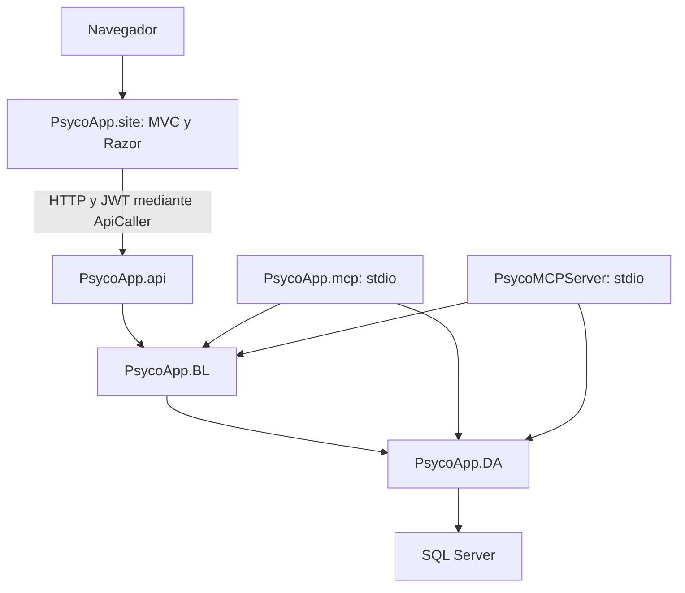

# Arquitectura

Fecha: 2026-10-29. Evidencia: verificado en referencias de proyectos y Startup/Program.

Las flechas MCP a DA representan referencias de proyecto; no prueban que todas las herramientas llamen directamente a DA.

| Proyecto | Referencias propias observadas |
|---|---|
| site | entities, utilities |
| api | BL, entities, utilities |
| BL | DA, entities |
| DA | entities, utilities |
| mcp y PsycoMCPServer | BL, DA, entities |

Entities comparte contratos y modelos. Utilities contiene ApiCaller, Helper, LOG y otras utilidades. Los proyectos principales apuntan a net10.0; utilities apunta a netcoreapp3.1. Se documenta el estado de los archivos, sin afirmar compatibilidad ejecutada.

El sitio configura MVC, compilación Razor en ejecución, PWA y sesión. La raíz dirige a SaaS/Index; la ruta convencional usa Login/Index. La API aplica autorización por defecto y autenticación JWT.

Fuentes: [solución](../../PSYCO_APP.sln), [site.csproj](../../PsycoApp.site/PsycoApp.site.csproj), [api.csproj](../../PsycoApp.api/PsycoApp.api.csproj), [BL.csproj](../../PsycoApp.BL/PsycoApp.BL.csproj), [DA.csproj](../../PsycoApp.DA/PsycoApp.DA.csproj), [utilities.csproj](../../PsycoApp.utilities/PsycoApp.utilities.csproj), [Startup sitio](../../PsycoApp.site/Startup.cs), [Startup API](../../PsycoApp.api/Startup.cs), [MCP](mcp.md).

Relacionados: [Acceso](acceso.md), [Datos](datos.md), [Guía de cambios](guia-de-cambios.md).
